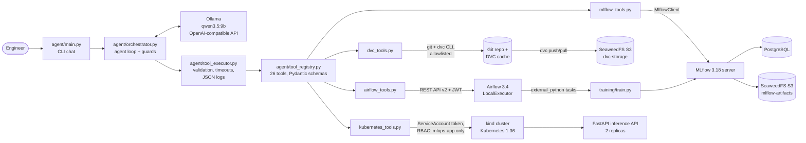
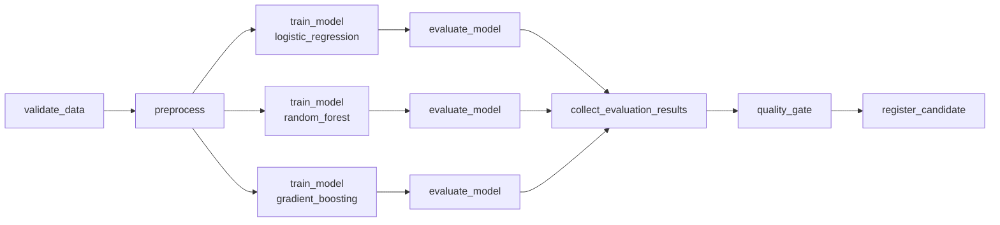

# Architecture

The MLOps agent answers natural-language questions by calling structured tools against four real
systems: DVC, MLflow, Apache Airflow and Kubernetes. Every operational claim in an answer must come
from a tool result produced while answering that question.

## Component diagram

## Runtime topology

| Where | Components |
|---|---|
| Docker Compose (WSL2) | SeaweedFS, MLflow server + PostgreSQL, Airflow api-server, scheduler, dag-processor, triggerer + PostgreSQL |
| kind cluster `mlops` | Namespace `mlops-app`: Deployment, ClusterIP Service, ConfigMap, agent ServiceAccount + Role |
| Host (WSL2) | Agent CLI, Ollama (GPU), DVC workspace, `uv` virtual environment |

## Data and model lineage

1. `scripts/download_dataset.py` downloads UCI Adult and writes `data/adult.csv` (tag `dataset-v1.0`).
2. `scripts/clean_dataset.py` strips whitespace and drops missing values (tag `dataset-v2.0`).
3. `dvc add` records the file's MD5 in `data/adult.csv.dvc`; `dvc push` uploads it to SeaweedFS.
4. Every training run is tagged with `dataset.md5`, `dataset.version`, `git.commit` and
   `git.dirty`, and logs the dataset as an MLflow dataset input.
5. The quality gate (F1 ≥ 0.60, recall ≥ 0.60, ROC-AUC ≥ 0.85) decides whether the best run is
   registered as `adult-income-classifier@candidate`.
6. `scripts/deploy_api.sh` exports `@candidate`, bakes it into image `adult-income-api:model-v<N>`
   and rolls it out; the API reports its model version and dataset version on `/version`.

The agent reverses this chain: MLflow run → `dataset.md5` → DVC tag → reproduction commands, and
deployed image → `/version` → registered model version → run.

## Training workflow (Airflow DAG `adult_income_training`)

Tasks run in a separate virtual environment (`@task.external_python`) so training packages never
conflict with Airflow's own. Each task retries twice, 30 seconds apart. A failed validation or
quality gate stops the run before `register_candidate`, so no model is promoted.

## Agent loop

1. The question and the 26 tool schemas are sent to the LLM.
2. The LLM returns tool calls; the executor validates arguments with Pydantic, runs the tool in a
   thread with a timeout and returns a `ToolResult` (`success`, `invalid_input`,
   `permission_denied`, `confirmation_required`, `unavailable`, `error`).
3. Results go back to the LLM until it writes a final answer (maximum 12 steps).

## Safety layers

| Risk | Control | Enforced by |
|---|---|---|
| Model approves its own state change | `confirmed` is not in any tool schema; `extra="forbid"` rejects it | Code |
| Retraining or restart without consent | State-changing tools pause for the user's `y`; anything else declines | Code |
| Actions outside the app namespace | Tool refuses any namespace except `mlops-app` | Code |
| Credentials misused despite code checks | ServiceAccount Role: read pods/logs/events/services, patch only `adult-income-api` | Kubernetes RBAC |
| Shell injection through tool inputs | Allowlisted read-only git/dvc commands, no shell, validated paths and names | Code |
| Invented results when a tool fails | Failed tools return no data; an "Unverified" list is appended by code | Code |
| Answer without evidence for this question | Coverage guard asks the model to query each required system once | Code |
| Secrets in logs | Values of `*PASSWORD*`, `*SECRET*`, `*TOKEN*`, `*KEY*` variables are redacted | Code |
| Airflow misuse | Dedicated `mlops_agent` user (role `user`), only `adult_income_training` may be triggered | Code + Airflow auth |
